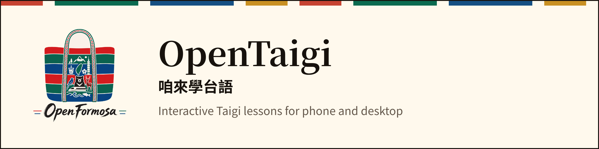

<p align="center"></p>

# OpenTaigi

OpenTaigi（咱來學台語）是手機與電腦都能用的互動式台語教學網站。它把教育部《咱來學臺灣閩南語》與 [Taiwanese-Corpus/Lan-Lai-Oh-Taigi](https://github.com/Taiwanese-Corpus/Lan-Lai-Oh-Taigi) 的公開資料，整理成可搜尋、可練習、有真人發音的教材。

<p align="center">
  <a href="LICENSE"></a>
  <a href="https://openformosa.github.io/OpenTaigi/"></a>
  
  <a href="https://discord.gg/N4YnrjjcW7"></a>
</p>

<p align="center"><b>繁體中文</b> · <a href="README.en.md">English</a></p>

<p align="center">
  <a href="https://openformosa.github.io/OpenTaigi/">打開網站</a> · <a href="docs/design-system.md">設計規範</a> · <a href="https://openformosa.com/community/">社群</a>
</p>

## 為什麼做這個

教育部的台語教材內容完整，但原本是 217 頁的 PDF。PDF 在手機上很難閱讀，也不能搜尋，音檔和文字分開放。

OpenTaigi 把這些教材重新編排成網頁。拼音與文章的音檔直接嵌在對應的音節、詞例或段落旁邊。學習者可以依程度選路線，也可以用聽力闖關和語詞配對練習。

## 快速開始

1. 打開 <https://openformosa.github.io/OpenTaigi/>。
2. 選擇程度：初學起步、生活應用或進階讀寫。
3. 點選任一語句，會聽到真人發音。

想在本機開發，見下一節。

## 安裝

| 項目 | 需求 |
| --- | --- |
| Node.js | 22.13 以上 |
| Python | 只在重新產生教材資料時需要 |

本機開發：

```bash
npm install
npm run dev
```

建置：

```bash
npm run build
npm run build:pages
```

推送到 `main` 後，GitHub Actions 會自動發佈 GitHub Pages。

## 使用範例

### 學習功能

- 初學起步、生活應用、進階讀寫三種程度與推薦路線。
- 依程度自動調整提示量、播放速度、閱讀字級與起始教材。
- 完整提示、台羅提示、挑戰模式可以隨時手動切換。
- 真人語句聽力闖關與語詞配對遊戲。
- 裝置內保存積分、目前連勝、最高連勝與答題數。

### 教材內容

- 拼音、語詞、語句、文章四階段教材入口。
- 教學模式依拼音、語詞、語句、文章重新編排，不照搬 PDF 版面。
- 217 頁 PDF 全文轉成可搜尋、可選取、可重排的 HTML。閱讀模式適合手機，原版模式保留來源文字的位置與比例。
- 840 句生活台語全文搜尋與 16 類主題篩選。
- 852 個校正後的語詞、台羅、華語與例詞。語詞頁整合詞頭、台羅、華語、例詞與 A／B 真人音檔。
- 真人發音、播放速度、羅馬字與華語提示切換。
- 隨機語句練習、頁面閱讀進度與繼續閱讀。

### 介面

- 桌機側欄、頁首換頁與手機底部導覽共用同一套教材體驗設計系統。
- 響應式版面與 GitHub Pages 自動部署。

介面規則與驗收標準見 [`docs/design-system.md`](docs/design-system.md)。

### 重新產生教材資料

原 PDF 含隱藏圖層與裁切內容，不能用一般文字擷取器直接讀取。`build_html_curriculum.py` 使用 PyMuPDF 只讀取實際顯示的文字層，再輸出定位版與手機閱讀版共用的資料。

```bash
python -m pip install -r scripts/requirements-pdf.txt
python scripts/build_curriculum.py /path/to/Lan-Lai-Oh-Taigi --skip-render
python scripts/build_html_curriculum.py /path/to/Lan-Lai-Oh-Taigi
```

## 文件

- [設計規範與驗收標準](docs/design-system.md)

## 限制

- 教材內容依原始來源，網站程式不更動原始語句、羅馬字與音檔。
- 學習紀錄只存在你的裝置上，換裝置或清除瀏覽器資料後不會保留。

## 參與貢獻

OpenFormosa 是社群專案，每個人都可以是貢獻者。

- 討論與提問：[Discord](https://discord.gg/N4YnrjjcW7) 或 [社群頁](https://openformosa.com/community/)
- 回報問題或提議功能：[Issues](https://github.com/OpenFormosa/OpenTaigi/issues)
- 送出修改：請先讀 [CONTRIBUTING.md](https://github.com/OpenFormosa/openformosa.com/blob/main/CONTRIBUTING.md)
- 一般聯絡：<hello@openformosa.com>
- 安全問題：<security@openformosa.com>（請不要公開發 issue）
- 行為準則：[CODE_OF_CONDUCT.md](https://github.com/OpenFormosa/openformosa.com/blob/main/CODE_OF_CONDUCT.md)，回報請寄 <conduct@openformosa.com>

## 授權

本 repository 的程式碼與原創文件以 [Apache License 2.0](LICENSE) 釋出，© 2026 OpenFormosa contributors。

教育部教材的語句、羅馬字與音檔不在此授權範圍內，依原始來源的條款使用。

## 致謝

教材來自教育部《咱來學臺灣閩南語》與 [Taiwanese-Corpus/Lan-Lai-Oh-Taigi](https://github.com/Taiwanese-Corpus/Lan-Lai-Oh-Taigi) 的整理。本專案的運算資源與研究支持來自 Taipei-1、臺大語音實驗室（NTU Speech Lab）與 NTU SPML Lab。感謝每一位提出問題、送出 PR 與參與討論的貢獻者。
